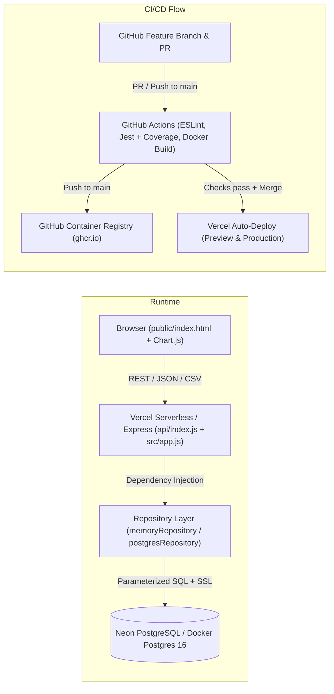

# Expense Tracker

[](https://github.com/himanshu-a11y/SystemDesignProject/actions/workflows/ci.yml)

A full-stack Expense Tracker web application built with Node.js, Express, PostgreSQL, Docker, GitHub Actions, and Vercel. Users can log, edit, filter, and export expenses, track monthly category budgets with overspend indicators, and visualize spending trends by category and month.

## Live Link

[Open the live application](https://system-design-project-ten.vercel.app)

---

## Features

- **Expense CRUD**: Add, edit (`PUT`), and delete (`DELETE`) expenses with title, amount, category (`Food`, `Travel`, `Study`, `Shopping`, `Other`), and ISO date.
- **Filtering & Sorting**: Filter expenses by category or date range (`from` / `to`) and sort by date or amount.
- **Monthly Category Budgets**: Set monthly spending limits per category with progress bars that turn red when over budget.
- **Interactive Charts**: Doughnut chart by category and bar chart of monthly spending via Chart.js.
- **CSV Export**: Download filtered or complete expense history as an escaped `.csv` file.
- **Repository Pattern**: Seamlessly switches between PostgreSQL (`pg`) in production/Docker and an in-memory repository for unit tests and zero-config local runs.

---

## Architecture



---

## Local Setup

Requires **Node.js 20+** (or **Docker Desktop** for the containerized Postgres stack).

### Option 1: Run with Node.js (In-Memory or External Postgres)

```bash
git clone https://github.com/himanshu-a11y/SystemDesignProject.git
cd SystemDesignProject
npm install
cp .env.example .env   # optional: set DATABASE_URL to use Postgres
npm start
```

Open [http://localhost:3000](http://localhost:3000).

### Option 2: Run with Docker Compose (App + Postgres 16)

```bash
docker compose up --build
```

`docker-compose.yml` starts PostgreSQL 16, initializes [db/schema.sql](db/schema.sql), waits for the database healthcheck, and starts the app on [http://localhost:3000](http://localhost:3000).

---

## Environment Variables

See [.env.example](.env.example) for a template and instructions on getting a free Neon connection string, and [docs/DEPLOYMENT.md](docs/DEPLOYMENT.md) for full Neon + Vercel setup.

| Variable | Description | Default |
|---|---|---|
| `PORT` | HTTP server port | `3000` |
| `DATABASE_URL` | PostgreSQL connection string (falls back to in-memory store if unset) | *(empty)* |

---

## Dependencies

- `express`: Web framework handling REST API routes, validation, and static file serving.
- `pg`: PostgreSQL client using a singleton `Pool` (`max: 3`) and parameterized queries for Neon and Docker Postgres.
- `jest` *(dev)*: Test runner executing unit/integration tests and enforcing coverage thresholds.
- `supertest` *(dev)*: HTTP assertion library for testing Express endpoints against the memory repository.
- `eslint` *(dev)*: Linter checking code quality across `src/`, `api/`, and `tests/`.
- `@eslint/js` *(dev)*: Official ESLint recommended ruleset for flat configuration (`eslint.config.js`).

---

## API Reference

| Method | Endpoint | Description |
|---|---|---|
| `GET` | `/health` | Returns `{"status":"ok"}` for healthchecks |
| `GET` | `/api/expenses` | List expenses (`?category=&from=&to=&sort=`) |
| `POST` | `/api/expenses` | Create expense (`title`, `amount`, `category`, optional `date`) |
| `PUT` | `/api/expenses/:id` | Update an existing expense |
| `DELETE` | `/api/expenses/:id` | Delete an expense by ID |
| `GET` | `/api/summary` | Total, count, and breakdown by category (`?from=&to=`) |
| `GET` | `/api/summary/monthly` | Monthly spending totals sorted chronologically |
| `GET` | `/api/budgets` | List configured category budgets |
| `PUT` | `/api/budgets/:category` | Set or update monthly budget (`{ amount }`) |
| `GET` | `/api/budgets/status` | Current month `spent`, `budget`, `remaining`, `overBudget` |
| `GET` | `/api/export.csv` | Download expenses as escaped CSV (supports filter query params) |

---

## Testing and Linting

```bash
npm run lint           # Run ESLint across the codebase
npm test               # Run all Jest + Supertest API tests
npm run test:coverage  # Run tests and enforce coverage thresholds
```

---

## CI/CD

- **Continuous Integration ([`.github/workflows/ci.yml`](.github/workflows/ci.yml))**: Triggers on every `push` and `pull_request` to `main`. Runs `npm ci`, `npm run lint`, `npm run test:coverage`, uploads the coverage artifact, and builds the Docker image only if linting and tests pass.
- **Container Registry ([`.github/workflows/docker-publish.yml`](.github/workflows/docker-publish.yml))**: Triggers on `push` to `main`, builds the image, and pushes it to `ghcr.io` tagged with `latest` and the commit SHA using `GITHUB_TOKEN`.
- **Deployment**: Vercel generates a preview URL for every pull request and automatically deploys `main` to production.

---

## Branching and PR Workflow

1. Create a feature branch from `main` (e.g., `feature/my-change`). Never commit directly to `main`.
2. Make small, focused commits using conventional prefixes (`feat:`, `fix:`, `test:`, `ci:`, `docs:`, `build:`).
3. Push the branch and open a Pull Request using [`.github/pull_request_template.md`](.github/pull_request_template.md).
4. Wait for GitHub Actions CI checks to pass, then have a teammate review and merge.

---

## Team

| Member | Role |
|---|---|
| Sahil Yadav | Application core, repository layer, and API tests |
| Himanshu Gurjar | Docker, PostgreSQL/Neon setup, and Vercel deployment |
| Suraj Nair | CI/CD pipelines, quality gates, frontend UI, and documentation |
